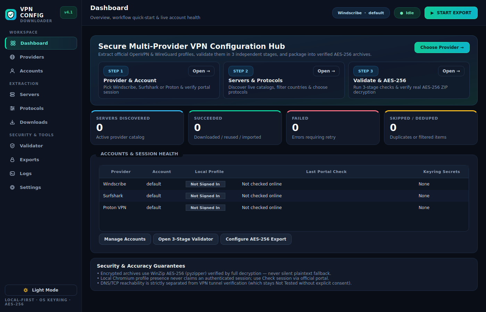

# VPN Config Downloader — Windscribe, Surfshark & Proton VPN

Download, manage and validate OpenVPN and WireGuard configurations on Windows and Linux.

A modular, cross-platform desktop application and command-line tool for **managing VPN accounts, discovering live server clusters, concurrently downloading configurations, performing 3-stage syntax and reachability validation, and producing AES-256 encrypted archives**.

Designed for **Ubuntu Linux** and **Windows 10/11**.

**Status: beta.** Provider portals and APIs can change. Account-gated downloads, real VPN tunnel connectivity and the Windows executable have not yet been verified end to end. See [Known issues](KNOWN_ISSUES.md) before using the optional connection probe.



> [!NOTE]
> For the Persian (Farsi) documentation guide, please refer to [README_FA.md](README_FA.md).

---

## Key Features

- **Extensible Provider Architecture**:
  - **Surfshark**: Live server cluster discovery, official bulk OpenVPN archives, and bulk WireGuard generation using a private key whose public key you have registered with the provider.
  - **Windscribe**: 2026 REST API integration for OpenVPN UDP/TCP and WireGuard profiles, official IKEv2 StrongSwan configurations, and experimental proxy kits.
  - **Proton VPN**: Browser-assisted Downloads portal driver for OpenVPN UDP/TCP and per-server WireGuard (`.conf`) profiles; sign-in and some portal actions require user interaction.
- **Concurrent Download Engine**:
  - Configurable worker pool (1 to 8 concurrent threads).
  - Rate limiting, exponential backoff, and automatic HTTP 429 cooldown handling.
  - Atomic writes with SHA-256 deduplication and persistent `checkpoint.json` recovery.
- **Secret Storage & Encrypted Exports**:
  - Saved OpenVPN service passwords, WireGuard private keys and session tokens use the system **OS Keyring**. Persistent Chromium profiles also retain browser session state; exported VPN profiles can contain plaintext private keys and explicitly included service credentials.
  - Sensitive tokens are automatically redacted from application logs and reports.
  - Export archives utilize **WinZip AES-256 encryption** with mandatory decryption verification before committing to disk.
- **3-Stage Profile Validator**:
  - *Syntax Validation*: Structural checks and warnings for directives, CA/TLS settings and WireGuard key formatting; this does not prove that a certificate or VPN tunnel is valid.
  - *Endpoint Reachability*: Non-destructive DNS resolution and TCP port probes.
  - *Optional Connection Probe*: An opt-in, non-routing OpenVPN probe (`--dev null --route-noexec --ifconfig-noexec`). It runs the supplied configuration and is **not an OS sandbox**: use only configurations you trust.
- **Modern 10-Page GUI**:
  - Built with PySide6 (Qt) featuring high-DPI vector icons and seamless **Dark (Obsidian)** and **Light (Porcelain)** themes.

---

## Supported Protocols Matrix

| Provider | WireGuard | OpenVPN UDP | OpenVPN TCP | IKEv2 / IPsec | Stealth / WStunnel |
|---|:---:|:---:|:---:|:---:|:---:|
| **Surfshark** | Key registration required | Official ZIP | Official ZIP | Templates; manual credentials + CA required | Unsupported |
| **Windscribe** | Supported (Pro API) | Supported (Pro API) | Supported (Pro API) | Supported (Datacenters API) | Experimental (Proxy Kits) |
| **Proton VPN** | Browser-assisted | Browser-assisted | Browser-assisted | Unsupported | Unsupported |

---

## Installation & Getting Started

### Prerequisites
- Python 3.11 or newer (Python 3.12 recommended).
- Git.

### Linux (Ubuntu / Debian)

```bash
# 1. Clone the repository
git clone https://github.com/MilMit/vpn-config-downloader.git
cd vpn-config-downloader

# 2. Make helper scripts executable
chmod +x scripts/*.sh

# 3. Install dependencies and browser support
./scripts/install_browser_linux.sh

# 4. Launch the application (or run: python3 run.py)
./scripts/run_linux.sh
```

### Windows 10/11

```bat
:: 1. Open Command Prompt or PowerShell in the project directory
scripts\install_browser_windows.bat

:: 2. Launch the application (or run: python run.py)
scripts\run_windows.bat
```

---

## Command-Line Interface (CLI)

The CLI supports Surfshark/Proton acquisition, provider listing and validation. Account-only acquisition can still open a browser:

```bash
# List available providers and standardized protocol matrix
python -m app.cli --list-providers

# Fetch and export Surfshark OpenVPN configurations to an AES-256 encrypted archive
python -m app.cli --provider surfshark --protocols udp,tcp --archive aes256 --remove-plaintext

# Validate an existing directory of configuration profiles
python -m app.cli --validate ~/Documents/MultiVPN-Configs/surfshark --check-reachability

# Test decryption integrity of an encrypted archive
python -m app.cli --verify-zip ~/Documents/MultiVPN-Configs/surfshark-AES256.zip
```

---

## Testing & Quality Assurance

The codebase includes an extensive suite of 77 unit, integration, and security tests:

```bash
# Install runtime and test/build dependencies first
python -m pip install -r requirements.txt -r requirements-build.txt

# Run test suite
python -m pytest -v

# Run offscreen GUI smoke tests
QT_QPA_PLATFORM=offscreen python -m tests.gui_smoke
```

---

## Building Executables

PyInstaller build orchestration resides in `build/build.py` with 1-click wrappers in `scripts/`:

- **Linux**: Run `./scripts/build_linux.sh` (or `python build/build.py --skip-browser-bundle` for a lightweight package).
- **Windows**: Run `scripts\build_windows.bat` on a Windows host.
- **CI/CD**: Pre-configured GitHub Actions workflow in `.github/workflows/test-and-build.yml` tests and packages artifacts on both platforms automatically.

Build output: `dist/VPNConfigDownloader/` (`VPNConfigDownloader` on Linux, `VPNConfigDownloader.exe` on Windows).

Existing settings, account profiles, OS Keyring entries and the default `MultiVPN-Configs` output folder retain their storage names for compatibility with earlier versions.

---

## License

This project's source code is licensed under the MIT License. See [LICENSE](LICENSE) for details. Third-party dependencies retain their own licenses.
